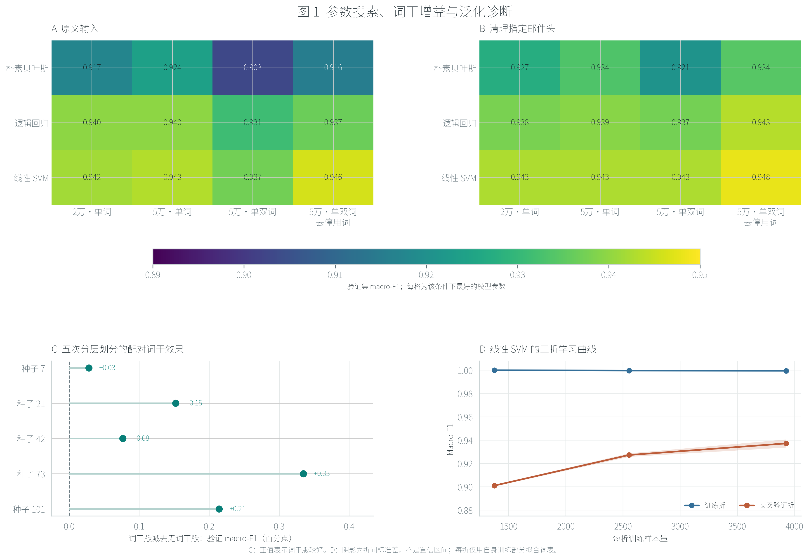
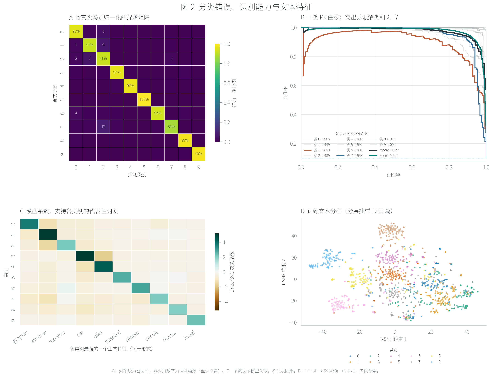

# 实验一：十类英文文本分类

> **最终实验结果（有标签数据的内部验证集）：**选定“清理指定邮件头（删除 From:、Organization: 等指定前缀的行） + 英文停用词过滤（去掉 the、and 等常见词） + Snowball 词干（按英文规则把部分词形归并） + 单词/双词 TF-IDF（同时使用单个词和相邻两个词作为特征） + `LinearSVC(C=0.5)`”。在固定的 1,474 条验证文本上，**准确率 94.84%（1,398/1,474）、macro-F1 0.9488**。用全部 7,368 条有标签文本重新训练后，已为 2,457 条无标签测试文本生成根目录的 `prediction.csv`。

## 1. 问题、假设与评价标准

- **任务：**读入一篇英文新闻/讨论组文本，预测其所属的 0～9 类。类别编号是数据标签。
- **待检验假设：****删除部分邮件头、调整 TF-IDF 词语表示、比较分类算法**，可能改善未见文本的分类；在较优配置上增加**词干提取**，也可能减少同一词不同形态造成的特征分散。**MLP（多层感知机）**作为后续模型探索，检验较复杂的非线性分类器是否带来额外收益。
- **选型规则：**以固定划分的验证集 **macro-F1** 为主要依据。对每个类别分别把它视作“正类”，计算查准率 $P_k=TP_k/(TP_k+FP_k)$、召回率 $R_k=TP_k/(TP_k+FN_k)$ 和 $F1_k=2P_kR_k/(P_k+R_k)$；再求十类的等权平均 $\mathrm{macro\text{-}F1}=\frac{1}{10}\sum_{k=0}^{9}F1_k$。分母为零时按评分实现记为 0。这样每一类对最终分数的权重相同，能看出总体正确篇数之外的类别表现；准确率则是“判对篇数/验证集总篇数”，不等于 macro-F1。先按这一指标比较 88 组候选，选出线性 SVM 的较优特征和参数；再在固定条件下配对比较有无词干，最后用相同词干特征比较三组 MLP。第 3 节列出了各阶段的准确率、macro-F1 和逐类错误；训练代价作为辅助判断，不代替主要指标。所有参数选择只依据带标签数据中划出的验证集，不用无标签测试集挑模型。

## 2. 数据、处理与实验设计

### （1）数据划分与训练流程

课程提供 `data/train_data.csv`（7,368 条，含 `text` 和 `target`）及 `data/test_data_unlabeled.csv`（2,457 条，仅有文本）。十类各约 705～747 条。固定**随机种子 42**，按类别比例分层抽取 80% 作训练集（5,894 条）、20% 作验证集（1,474 条）；88 组原始搜索、词干对照及 MLP 对照使用相同的正式训练/验证索引。

每个候选都按“加载数据 → 清理文本 → **仅用训练部分拟合 TF-IDF 词表** → 训练分类器 → 预测验证部分 → 记录准确率、macro-F1 等指标”的顺序运行。`scikit-learn` 的 `.fit()` 完成优化过程：朴素贝叶斯估计词频，逻辑回归和线性 SVM 优化线性权重，MLP 在内部逐轮更新网络权重；MLP 的实际轮数另行记录。这样验证文本不会参与词表学习或模型拟合。选型结束后，才用全部有标签文本重新拟合选定方案并预测无标签测试集。

### （2）文本与特征处理

- **头部处理：**比较原文与 `clean_headers`。后者删除以 `From:`、`Organization:`、`Lines:`、`Nntp-Posting-Host:` 等指定前缀开头的行，仍保留其他正文和未列出的头部。
- **TF-IDF：**将词语及相邻双词转成数值特征；TF-IDF 使在单篇中出现、但并非篇篇常见的词得到较高权重。所有方案均使用 `min_df=2`（训练集中至少出现于两篇文档）和 `sublinear_tf=True`（反复出现的词，权重增长放缓）。比较最多 2 万/5 万特征、只用单词/同时用单词与双词、是否去英文停用词。停用词如 *the*、*and*；过滤由英文停用词表完成。
- **标点与词干：**默认分词及词干版分词都不会把标点当作独立词特征，但没有另做全面的标点清洗或拼写纠错。词干版先过滤停用词，再用 Snowball English 合并部分词形，例如让相关变形更可能共享词项；这可能减小词表分散，也可能抹掉有用的词形区别。

### （3）按结果逐步扩展的对照设计

1. **起点与 88 组搜索。**原项目的 `draft_main.py` 用默认 `SVC()` 直接训练并导出预测，没有内部验证分数，因此只是流程起点，不作为可比较的数值基线。新实验比较 **2 种文本输入 × 4 种 TF-IDF 设置 × 11 组分类器参数 = 88 组**：多项式朴素贝叶斯 `alpha={0.1,0.5,1}`（3 组），逻辑回归 `C={0.3,1,3,10}`（4 组），线性 SVM `C={0.1,0.5,1,3}`（4 组）。`alpha` 是对低频/未见词的平滑程度；`C` 越大，线性模型通常越强调拟合训练数据。这里的 `LinearSVC` 与原脚本默认的核 SVC 是不同实现，不能把两者成绩直接视为同一模型的调参结果。
2. **依据 88 组结果追加词干。**三个算法各自在所试范围内的最佳结果，都落在“清理指定头部 + 最多 5 万特征 + 单词和双词 + 去停用词”这一特征设置；其中总体最佳是 `LinearSVC(C=0.5)`。因此固定头部处理、TF-IDF 容量、词组范围和模型参数，只在“保留/去除停用词 × 不用/使用词干”上做配对比较。两组无词干配置已在 88 组中出现，并重新运行核对；只新增 **2 个不同的词干配置**，故传统模型合计 **90 个不同配置**。这一步回答的是“在选定线性 SVM 条件下，词干是否有用”，不能外推到全部算法。
3. **依据词干结果追加 MLP。**词干版成为最高分配置后，保持正式划分、头部处理和同一套带词干 TF-IDF 特征，另外预定三组 `MLPClassifier`：一层 50 个神经元、`alpha=0.0001`；一层 100 个神经元、`alpha=0.0001`；一层 100 个神经元、`alpha=0.01`。`alpha` 是限制过大网络权重的正则化强度。三组均用 Adam、批量 256、最多 50 轮，并从训练部分内部再留 10% 监测提前停止（连续 5 轮无足够改善即停）；正式验证集只在训练结束后评分。MLP 是追加的同特征算法对照。

## 3. 结果、图表与误差分析

### （1）88 组搜索：确定后续探索的起点

*图 1。A/B 把原 88 组压缩成“文本处理 × 特征设置 × 算法”的性能地图；每格是该条件下所试参数的最高验证 macro-F1，显示的是分组最优值。C 为同一种子、相同训练/验证索引下“有词干减无词干”的配对差，单位是百分点；D 为另做的三折学习曲线，阴影表示折间标准差。*

- **特征选择证据：**图 1A/B 显示清理头部后的最佳线性 SVM 达 0.948；同一列的逻辑回归、朴素贝叶斯最好分别约 0.943、0.934。各算法的最高分都在“5 万、单词+双词、去停用词”列，但其他列的优劣并非处处单调，例如单纯增加双词而不去停用词未必提升成绩。因此后续固定的是观察到的较优特征组合。
- **算法选择证据：**88 组各自最佳验证准确率/macro-F1 为：朴素贝叶斯 **0.9335/0.9343**，逻辑回归 **0.9430/0.9434**，线性 SVM **0.9478/0.9481**。三种算法搜索数量分别为 24、32、32 组，搜索范围并不完全相同；在上述配置范围内，线性 SVM 最好。

### （2）词干与 MLP：固定已选特征的追加实验

| 阶段及模型 | 验证准确率 | 验证 macro-F1 | 解释 |
|---|---:|---:|---|
| 原 88 组最佳：线性 SVM，无词干 | 0.9478 | 0.9481 | 1,397/1,474 正确 |
| 加 Snowball 词干，其他条件相同 | **0.9484** | **0.9488** | 1,398/1,474 正确，最终选定 |
| MLP：一层 50 单元，`alpha=0.0001` | 0.9410 | 0.9416 | 三组 MLP 中最好，训练 25 轮 |
| MLP：一层 100 单元，`alpha=0.0001` | 0.9362 | 0.9369 | 第 10 轮停止 |
| MLP：一层 100 单元，`alpha=0.01` | 0.9349 | 0.9355 | 第 10 轮停止 |

- **词干收益较小：**在去停用词的最终条件下，macro-F1 从 0.94806 到 0.94883，差 0.00076；准确率只多对 1 篇。在保留停用词的配对条件下，macro-F1 从 0.93917 到 0.94200。这说明词干方向有小幅收益。为检查是否只碰巧适合种子 42，固定参数后又做 5 个分层 80:20 划分（图 1C）；五次词干版 macro-F1 均高于对应无词干版，平均高 0.00161。有词干版五次平均 macro-F1 0.9467，范围 0.9397～0.9547；这些重叠划分是稳健性检查，不是独立测试集。
- **MLP 得到结论：**在已选词干特征上，三组 MLP 都没有超过线性 SVM。50 单元组最高，100 单元组增大 `alpha` 后也没有改善；因此“增加神经元或正则化一定更好”不被这三次结果支持。三组均因内部提前停止在 25/10/10 轮结束，未出现收敛警告；约 43/35/35 秒为分类器拟合耗时，公共 TF-IDF 拟合另约 8 秒。不同脚本的计时环境并非严格受控，只宜作训练成本的粗略参考。三组是有限候选，不能断言所有 MLP 都不如 SVM。

### （3）分类错误、识别能力与特征解释

*图 2 使用最终方案在种子 42 的正式验证集上重新拟合并复现 0.9488 的 macro-F1。A 为按真实类别归一化的混淆矩阵，对角线是各类召回率，非对角数字为至少 3 篇的误判数；B 为十类 One-vs-Rest PR 曲线，粗线突出类别 2、7，并附 macro/micro PR-AUC；C 是 `LinearSVC` 每类最强正向词项的模型系数；D 是训练文本抽样 1,200 篇的 TF-IDF → SVD → t-SNE 探索性投影。*

- **主要错误：**真实类别 **7 → 预测 2：12 篇**，是最大的单一误判方向；真实 1 → 2 有 9 篇，真实 2 → 1 有 7 篇。类别 7 的召回率约 86%，低于多数类别；类别 2 的 PR-AUC 约 0.899，也是十类中最低。
- **特征与分布：**图 2C 中各类高正向系数词项如 `graphic`、`window`、`car` 等，显示模型确实利用了有区别度的词项。图 2D 有局部聚集也有交叠，与“多数文本易分、少数类别混淆”的观察相容。
- **额外可靠性检查：**按当前头部清理规则，种子 42 的验证集中有 3 条文本与其训练部分完全相同；排除这 3 条后，词干版 macro-F1 为 0.94875，接近原值 0.94883。这排查了规则定义下的完全重复，不能排除近似重复。五个 80% 训练模型对无标签测试文本中 2,340/2,457 条预测完全一致；一致说明结果对这些划分较稳定。

## 4. 对课程三个思考题的回答

1. **为什么 SVM、逻辑回归常适合 TF-IDF 文本？**词表可达数万维，而单篇文章只含其中少量词，形成高维稀疏矩阵。线性 SVM 与逻辑回归直接学习词项权重，能够利用稀疏表示；本实验各自最好的原 88 组 macro-F1 是 0.9481 与 0.9434，优于所试朴素贝叶斯的 0.9343。
2. **MLP 能否靠层数、神经元或训练轮数继续提升？有过拟合风险吗？**有可能，但没有哪一种增加方式必然有效。更深或更宽的网络能表示更复杂的关系，也会增加参数量、训练成本和过拟合风险；训练轮数更多只表示继续优化训练目标，验证表现可能先升后降。应使用独立验证数据比较结构和轮数，并结合 L2 正则化、Dropout 或提前停止控制过拟合；若训练分数持续上升而验证分数下降，就应停止训练或减小模型复杂度。
3. **TF-IDF 之外还能怎样表示文本？**词袋计数直接记录词频，简单但没有 TF-IDF 对常见词的降权；Word2Vec 用稠密词向量表达词语相近性，还需把多个词聚合为篇章表示；BERT 可根据上下文产生词/句表示，潜力更大，但训练、推理和调参成本也更高。

## 5. 结论、局限与复现

**结论：**按“88 组受控搜索 → 固定较优条件做词干配对 → 同特征比较三组 MLP”的实际顺序，验证 macro-F1 最高的已运行方案为词干版 `LinearSVC(C=0.5)`。单词与双词共同表示、在固定条件下做词干消融，是本实验在基础算法比较之外的特征改进与可解释对照；不能声称使用了未运行的新模型。最终预测文件为根目录的 `prediction.csv`，无表头，共 2,457 行。

**局限：**词干相对原最佳只多判对一篇，增益很小；先用同一验证集筛选 88 组，再继续观察词干和 MLP，最高验证分可能有选择偏乐观。五次划分相互重叠，不能提供独立测试成绩或严格置信区间。MLP 搜索只有三组，未覆盖层数和更多训练策略。头部清理并非纯正文提取，误判文本未人工逐篇核验，近似重复和数据来源变化仍可能影响真实泛化。无标签测试集的真实准确率目前无法计算。

**复现：**使用 `project1` 环境，在项目目录依次运行 `run_experiment.py --mode full`、`run_stemming_comparison.py`、`run_mlp_comparison.py`；`check_reliability.py` 用于补充稳健性检查。原始逐组结果、词干配对、MLP 轮数与分数分别保存在 `experiment_results/baseline/validation_results.csv`、`experiment_results/stemming/stemming_comparison.csv`、`experiment_results/mlp/mlp_validation_results.csv`；数据划分、环境版本及最佳配置见各目录 JSON。本文两张最终图片位于 `report_assets/`。
